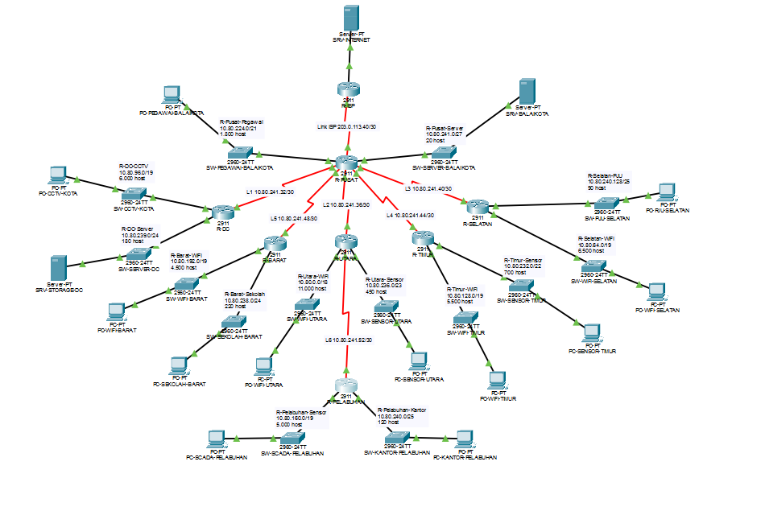
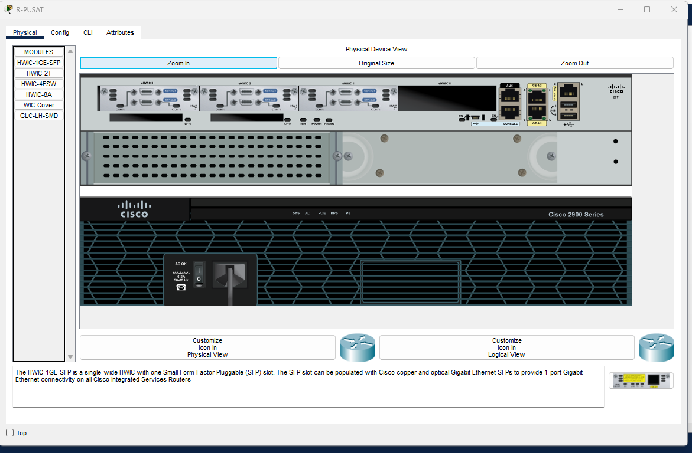
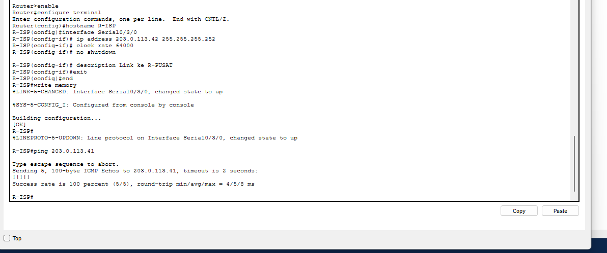
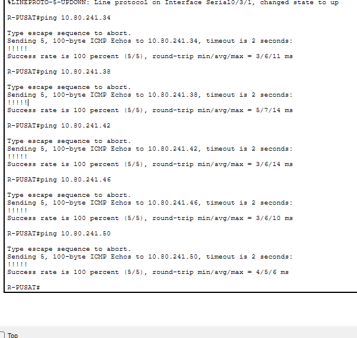
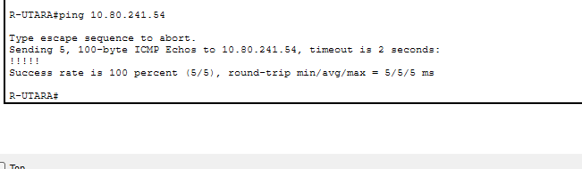
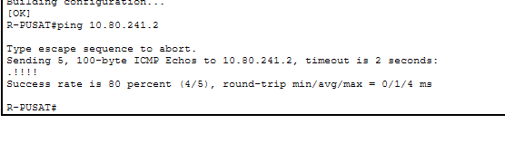
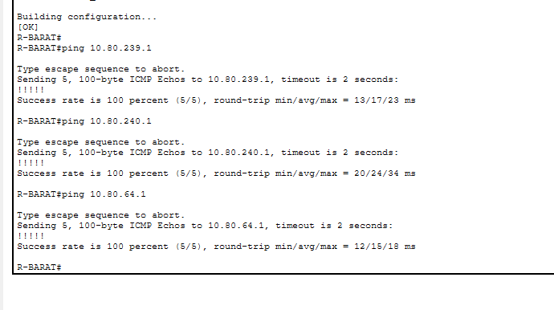
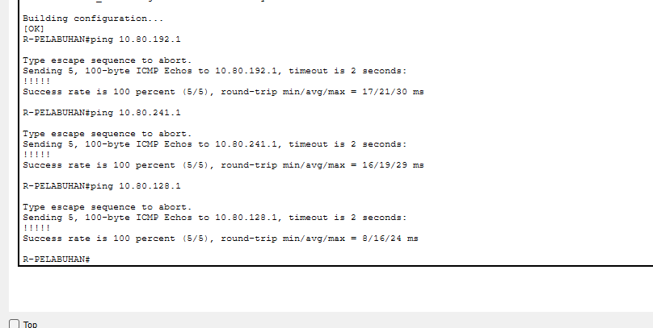

# Mid-Project Jarkom A: Implementasi Jaringan Smart City Kota Surabaya

**Kelompok 10 (K = 10)** | Komunikasi Data dan Jaringan Komputer (ET234306) | Semester Gasal 2026/2027

| Kelompok 10 |
| ----------- |

| Nama                    | NRP        | Pengerjaan |
| ----------------------- | ---------- | ---------- |
| Ryan Adya Purwanto      | 502723     | 1, 2, 3    |
| Nazwa Aulia Dwi Purnomo | 5027251018 | 4, 5, 8    |
| Farrel Arteya Kumara    | 5027251020 | 6 dan 7    |

---

| Keterangan               | Isi                              |
| ------------------------ | -------------------------------- |
| Base network (hasil UTS) | 10.80.0.0/16                     |
| Skema yang dipilih       | **VLSM**                         |
| Domain internal          | k10.smartcity.lab                |
| File Packet Tracer       | `K10_VLSM.pkt`                   |
| Spreadsheet subnetting   | `K10_Subnetting_MidProject.xlsx` |
| File Packet Tracer (2)   | `K10_DHCP-NAT-LAYANAN.pkt`       |
| File Packet Tracer OSPF  | `K10_VLSM_OSPF.pkt`              |

---

## Status pengerjaan

| Soal | Bagian                      | Status  |
| ---- | --------------------------- | ------- |
| 1    | Perancangan topologi        | Selesai |
| 2    | Tabel subnetting            | Selesai |
| 3    | Static routing              | Selesai |
| 4    | DHCP                        | Selesai |
| 5    | NAT                         | Selesai |
| 6    | Tunnel GRE                  | Selesai |
| 7    | Dynamic routing OSPF        | Selesai |
| 8    | Layanan aplikasi Smart City | Selesai |

---

## Alasan memilih VLSM

Kebutuhan host terbesar adalah 11.000 (WiFi Publik Utara), yang memerlukan prefix /18 atau 16.384 alamat.

Pada skema CIDR seluruh subnet dibuat seragam, sehingga keempat belas LAN masing-masing memakai /18:

```
14 x 16.384 = 229.376 alamat
```

Induk 10.80.0.0/16 hanya menyediakan 65.536 alamat, jadi skema CIDR seragam tidak muat di dalamnya dan induknya harus diperlebar menjadi 10.80.0.0/14. Pemborosannya juga besar: LAN Server Balai Kota yang hanya butuh 20 host tetap mendapat 16.382 alamat.

Dengan VLSM, total alamat yang terpakai hanya 61.756 dari 65.536 yang tersedia, atau sekitar 94 persen. Seluruh rancangan tetap muat di dalam induk /16 yang diberikan. Karena itu VLSM dipilih untuk implementasi di Packet Tracer.

Perbandingan lengkap kedua skema, termasuk tabel supernet per router untuk CIDR, ada di file `K10_Subnetting_MidProject.xlsx`.

---

## Soal 1: Perancangan topologi



### Perangkat yang dipakai

| Jenis  | Jumlah | Model      |
| ------ | ------ | ---------- |
| Router | 8      | Cisco 2911 |
| Switch | 14     | Cisco 2960 |
| PC     | 12     | PC-PT      |
| Server | 3      | Server-PT  |

### Pertimbangan desain

**Backbone memakai serial, bukan Ethernet.** Router 2911 hanya memiliki 3 port GigabitEthernet bawaan, sedangkan R-PUSAT harus melayani 8 sambungan sekaligus: 1 ke R-ISP, 5 ke router wilayah (L1 sampai L5), dan 2 ke LAN miliknya sendiri. Solusinya, ketiga port Gigabit dipakai untuk LAN, dan seluruh sambungan antar-router memakai port serial dari modul tambahan **HWIC-2T** (2 port serial per modul).



Jumlah modul per router: R-PUSAT 3 modul (6 port serial), R-UTARA 2 modul, router lainnya 1 modul.

**Satu switch per LAN.** Tiap LAN diberi switch 2960 tersendiri agar domain broadcast tiap subnet terpisah dan penambahan perangkat di kemudian hari tidak mengubah konfigurasi router.

**Satu perangkat perwakilan per LAN.** Sesuai ketentuan soal, tiap LAN cukup diisi satu perangkat, namun perhitungan subnet tetap memakai jumlah host penuh. LAN yang berisi server (Server Balai Kota, Server dan Storage DC) memakai perangkat Server-PT, sisanya PC-PT.

**Server internet tanpa switch.** SRV-INTERNET (8.8.8.8) disambung langsung ke R-ISP karena merupakan satu-satunya perangkat di segmen tersebut.

**Media link.** Seluruh sambungan router ke switch dan switch ke perangkat memakai kabel Copper Straight-Through, karena menghubungkan perangkat dengan jenis port berbeda. Sambungan antar-router memakai Serial DCE, dengan sisi DCE selalu berada di router yang posisinya lebih dekat ke inti jaringan.

### Penamaan

Seluruh perangkat diganti namanya agar menunjukkan lokasinya, misalnya `R-PUSAT`, `SW-CCTV-KOTA`, `PC-SENSOR-TIMUR`. Tiap LAN juga diberi label di kanvas berisi nama subnet, Network ID beserta prefix, dan jumlah host. Tiap link backbone diberi label berisi nomor link dan network /30 miliknya.

---

## Soal 2: Tabel subnetting

Tabel lengkap ada di `K10_Subnetting_MidProject.xlsx`, terdiri atas enam sheet: Ringkasan, VLSM, Link dan Tambahan, CIDR, Supernet per Router, dan Revisi.

### Ringkasan VLSM

| No  | Subnet             | Host   | Prefix | Network ID    | Range Host                    | Broadcast     | Gateway       |
| --- | ------------------ | ------ | ------ | ------------- | ----------------------------- | ------------- | ------------- |
| 1   | R-Utara-WiFi       | 11.000 | /18    | 10.80.0.0     | 10.80.0.1 - 10.80.63.254      | 10.80.63.255  | 10.80.0.1     |
| 2   | R-Selatan-WiFi     | 6.500  | /19    | 10.80.64.0    | 10.80.64.1 - 10.80.95.254     | 10.80.95.255  | 10.80.64.1    |
| 3   | R-DC-CCTV          | 6.000  | /19    | 10.80.96.0    | 10.80.96.1 - 10.80.127.254    | 10.80.127.255 | 10.80.96.1    |
| 4   | R-Timur-WiFi       | 5.500  | /19    | 10.80.128.0   | 10.80.128.1 - 10.80.159.254   | 10.80.159.255 | 10.80.128.1   |
| 5   | R-Pelabuhan-Sensor | 5.000  | /19    | 10.80.160.0   | 10.80.160.1 - 10.80.191.254   | 10.80.191.255 | 10.80.160.1   |
| 6   | R-Barat-WiFi       | 4.500  | /19    | 10.80.192.0   | 10.80.192.1 - 10.80.223.254   | 10.80.223.255 | 10.80.192.1   |
| 7   | R-Pusat-Pegawai    | 1.800  | /21    | 10.80.224.0   | 10.80.224.1 - 10.80.231.254   | 10.80.231.255 | 10.80.224.1   |
| 8   | R-Timur-Sensor     | 700    | /22    | 10.80.232.0   | 10.80.232.1 - 10.80.235.254   | 10.80.235.255 | 10.80.232.1   |
| 9   | R-Utara-Sensor     | 450    | /23    | 10.80.236.0   | 10.80.236.1 - 10.80.237.254   | 10.80.237.255 | 10.80.236.1   |
| 10  | R-Barat-Sekolah    | 220    | /24    | 10.80.238.0   | 10.80.238.1 - 10.80.238.254   | 10.80.238.255 | 10.80.238.1   |
| 11  | R-DC-Server        | 180    | /24    | 10.80.239.0   | 10.80.239.1 - 10.80.239.254   | 10.80.239.255 | 10.80.239.1   |
| 12  | R-Pelabuhan-Kantor | 120    | /25    | 10.80.240.0   | 10.80.240.1 - 10.80.240.126   | 10.80.240.127 | 10.80.240.1   |
| 13  | R-Selatan-PJU      | 90     | /25    | 10.80.240.128 | 10.80.240.129 - 10.80.240.254 | 10.80.240.255 | 10.80.240.129 |
| 14  | R-Pusat-Server     | 20     | /27    | 10.80.241.0   | 10.80.241.1 - 10.80.241.30    | 10.80.241.31  | 10.80.241.1   |

Gateway tiap LAN adalah alamat host pertama, sesuai ketentuan soal.

### Link antar-router

| Link | Network         | Router A | IP A         | Router B    | IP B         |
| ---- | --------------- | -------- | ------------ | ----------- | ------------ |
| L1   | 10.80.241.32/30 | R-PUSAT  | 10.80.241.33 | R-DC        | 10.80.241.34 |
| L2   | 10.80.241.36/30 | R-PUSAT  | 10.80.241.37 | R-UTARA     | 10.80.241.38 |
| L3   | 10.80.241.40/30 | R-PUSAT  | 10.80.241.41 | R-SELATAN   | 10.80.241.42 |
| L4   | 10.80.241.44/30 | R-PUSAT  | 10.80.241.45 | R-TIMUR     | 10.80.241.46 |
| L5   | 10.80.241.48/30 | R-PUSAT  | 10.80.241.49 | R-BARAT     | 10.80.241.50 |
| L6   | 10.80.241.52/30 | R-UTARA  | 10.80.241.53 | R-PELABUHAN | 10.80.241.54 |
| L7   | 10.80.241.56/30 | R-DC     | 10.80.241.57 | R-UTARA     | 10.80.241.58 |

L7 adalah link cadangan yang hanya dipasang di file OSPF, sesuai soal 7. Prefix /30 dipakai karena tiap link hanya memerlukan dua alamat host.

### Alamat tambahan dari soal

| Keperluan             | Alamat                                      |
| --------------------- | ------------------------------------------- |
| Link R-PUSAT ke R-ISP | 203.0.113.40/30, R-PUSAT .41, R-ISP .42     |
| Server internet       | 8.8.8.0/24, server 8.8.8.8, gateway 8.8.8.1 |
| Tunnel GRE            | 192.168.10.0/30, R-PUSAT .1, R-PELABUHAN .2 |

### Tabel revisi

Terdapat kesalahan hitung pada lembar jawaban UTS yang sudah diperbaiki dan dicatat. Kesalahan utamanya ada pada baris R-Barat-WiFi: broadcast ditulis 10.80.199.255, padahal blok /19 berisi 8.192 alamat yang setara 32 angka pada oktet ketiga, sehingga broadcast yang benar adalah 10.80.223.255. Angka 199 berasal dari lompatan 8, yang merupakan pola /21. Karena alokasi VLSM bersifat berurutan, kesalahan ini menggeser delapan baris di bawahnya.

Rincian lengkap tiga belas baris revisi beserta alasannya ada di sheet **Revisi** pada file spreadsheet.

---

## Soal 3: Static routing

### Peta interface

| Router      | Interface | Alamat           | Keterangan                      |
| ----------- | --------- | ---------------- | ------------------------------- |
| R-ISP       | Gi0/0     | 8.8.8.1/24       | LAN server internet             |
| R-ISP       | Se0/3/0   | 203.0.113.42/30  | Link ke R-PUSAT                 |
| R-PUSAT     | Gi0/0     | 10.80.224.1/21   | LAN Pegawai Balai Kota          |
| R-PUSAT     | Gi0/1     | 10.80.241.1/27   | LAN Server Balai Kota           |
| R-PUSAT     | Se0/1/0   | 203.0.113.41/30  | Link ke R-ISP                   |
| R-PUSAT     | Se0/1/1   | 10.80.241.33/30  | L1 ke R-DC                      |
| R-PUSAT     | Se0/2/0   | 10.80.241.37/30  | L2 ke R-UTARA                   |
| R-PUSAT     | Se0/2/1   | 10.80.241.41/30  | L3 ke R-SELATAN                 |
| R-PUSAT     | Se0/3/0   | 10.80.241.45/30  | L4 ke R-TIMUR                   |
| R-PUSAT     | Se0/3/1   | 10.80.241.49/30  | L5 ke R-BARAT                   |
| R-DC        | Gi0/0     | 10.80.96.1/19    | LAN CCTV Kota                   |
| R-DC        | Gi0/1     | 10.80.239.1/24   | LAN Server dan Storage DC       |
| R-DC        | Se0/3/0   | 10.80.241.34/30  | L1 ke R-PUSAT                   |
| R-BARAT     | Gi0/0     | 10.80.192.1/19   | LAN WiFi Publik Barat           |
| R-BARAT     | Gi0/1     | 10.80.238.1/24   | LAN Puskesmas dan Sekolah Barat |
| R-BARAT     | Se0/3/0   | 10.80.241.50/30  | L5 ke R-PUSAT                   |
| R-UTARA     | Gi0/0     | 10.80.0.1/18     | LAN WiFi Publik Utara           |
| R-UTARA     | Gi0/1     | 10.80.236.1/23   | LAN Sensor Lalu Lintas Utara    |
| R-UTARA     | Se0/3/0   | 10.80.241.38/30  | L2 ke R-PUSAT                   |
| R-UTARA     | Se0/2/0   | 10.80.241.53/30  | L6 ke R-PELABUHAN               |
| R-TIMUR     | Gi0/0     | 10.80.128.1/19   | LAN WiFi Publik Timur           |
| R-TIMUR     | Gi0/1     | 10.80.232.1/22   | LAN Sensor Banjir Timur         |
| R-TIMUR     | Se0/3/0   | 10.80.241.46/30  | L4 ke R-PUSAT                   |
| R-SELATAN   | Gi0/0     | 10.80.64.1/19    | LAN WiFi Publik Selatan         |
| R-SELATAN   | Gi0/1     | 10.80.240.129/25 | LAN PJU Pintar Selatan          |
| R-SELATAN   | Se0/3/0   | 10.80.241.42/30  | L3 ke R-PUSAT                   |
| R-PELABUHAN | Gi0/0     | 10.80.160.1/19   | LAN Sensor dan SCADA Pelabuhan  |
| R-PELABUHAN | Gi0/1     | 10.80.240.1/25   | LAN Kantor Pelabuhan            |
| R-PELABUHAN | Se0/3/0   | 10.80.241.54/30  | L6 ke R-UTARA                   |

### Alamat statis yang sudah diisi

| Perangkat      | IP          | Mask            | Gateway     |
| -------------- | ----------- | --------------- | ----------- |
| SRV-BALAIKOTA  | 10.80.241.2 | 255.255.255.224 | 10.80.241.1 |
| SRV-STORAGE-DC | 10.80.239.2 | 255.255.255.0   | 10.80.239.1 |
| SRV-INTERNET   | 8.8.8.8     | 255.255.255.0   | 8.8.8.1     |

Seluruh PC sengaja dibiarkan tanpa alamat karena akan memperoleh IP dinamis lewat DHCP (soal 4).

### Konfigurasi interface

Contoh pada R-PUSAT:

```
enable
configure terminal
hostname R-PUSAT
interface GigabitEthernet0/0
 description LAN Pegawai Balai Kota
 ip address 10.80.224.1 255.255.248.0
 no shutdown
exit
interface Serial0/1/0
 description Link ke R-ISP
 ip address 203.0.113.41 255.255.255.252
 clock rate 64000
 no shutdown
exit
end
write memory
```

Perintah `clock rate` diberikan pada tiap interface serial. Hanya sisi DCE yang benar-benar memakainya untuk menentukan kecepatan sinkronisasi link, sedangkan sisi DTE mengabaikannya.

### Rute

Aturan yang dipakai sesuai ketentuan soal: default route hanya mengarah ke router di atasnya, dan hanya R-PUSAT serta R-UTARA yang memiliki static route ke jaringan di bawahnya.

**Router daun**, masing-masing cukup satu default route:

```
R-DC          ip route 0.0.0.0 0.0.0.0 10.80.241.33
R-BARAT       ip route 0.0.0.0 0.0.0.0 10.80.241.49
R-TIMUR       ip route 0.0.0.0 0.0.0.0 10.80.241.45
R-SELATAN     ip route 0.0.0.0 0.0.0.0 10.80.241.41
R-PELABUHAN   ip route 0.0.0.0 0.0.0.0 10.80.241.53
```

R-PELABUHAN mengarah ke R-UTARA, bukan R-PUSAT, karena posisinya berada di bawah R-UTARA.

**R-UTARA**, default ke atas ditambah rute ke dua LAN milik R-PELABUHAN:

```
ip route 0.0.0.0 0.0.0.0 10.80.241.37
ip route 10.80.160.0 255.255.224.0 10.80.241.54
ip route 10.80.240.0 255.255.255.128 10.80.241.54
```

**R-PUSAT**, default ke R-ISP ditambah rute ke seluruh LAN di bawahnya:

```
ip route 0.0.0.0 0.0.0.0 203.0.113.42
ip route 10.80.96.0 255.255.224.0 10.80.241.34
ip route 10.80.239.0 255.255.255.0 10.80.241.34
ip route 10.80.0.0 255.255.192.0 10.80.241.38
ip route 10.80.236.0 255.255.254.0 10.80.241.38
ip route 10.80.160.0 255.255.224.0 10.80.241.38
ip route 10.80.240.0 255.255.255.128 10.80.241.38
ip route 10.80.241.52 255.255.255.252 10.80.241.38
ip route 10.80.64.0 255.255.224.0 10.80.241.42
ip route 10.80.240.128 255.255.255.128 10.80.241.42
ip route 10.80.128.0 255.255.224.0 10.80.241.46
ip route 10.80.232.0 255.255.252.0 10.80.241.46
ip route 10.80.192.0 255.255.224.0 10.80.241.50
ip route 10.80.238.0 255.255.255.0 10.80.241.50
```

Dua LAN milik R-PELABUHAN diarahkan ke R-UTARA karena R-PELABUHAN tidak tersambung langsung ke R-PUSAT.

**R-ISP** tidak diberi rute apa pun ke alamat privat, sesuai syarat soal 5. Akses host internal ke 8.8.8.8 akan ditangani NAT di R-PUSAT.

---

## Bukti pengujian

### Link ISP



### Backbone dari R-PUSAT ke lima router wilayah



### Link L6 dari R-UTARA ke R-PELABUHAN



### LAN Server Balai Kota dari R-PUSAT



### Routing lintas wilayah dari R-BARAT

Menguji jangkauan ke LAN Server DC, LAN Kantor Pelabuhan (tiga hop lewat R-PUSAT dan R-UTARA), dan LAN WiFi Selatan.



### Routing lintas wilayah dari R-PELABUHAN

Menguji arah sebaliknya, dari titik terjauh dalam topologi.



Seluruh pengujian menghasilkan success rate 100 persen.

---

## SOAL 4: Konfigurasi DHCP

### Konsep yang Dipakai

**DHCP (Dynamic Host Configuration Protocol)** membagikan alamat IP, subnet mask, default gateway, dan DNS server secara otomatis kepada klien. Prosesnya empat tahap (**DORA**): klien mengirim _Discover_, server membalas _Offer_, klien mengirim _Request_, dan server menutup dengan _Acknowledge_.

**DHCP Pool** adalah rentang alamat yang boleh dipinjamkan. Perintah `ip dhcp excluded-address` mengecualikan alamat tertentu (gateway dan perangkat static) agar tidak ikut dibagikan.

**DHCP Relay (`ip helper-address`)** diperlukan karena _DHCP Discover_ berupa broadcast yang tidak diteruskan oleh router. Jika server DHCP berada di LAN yang berbeda dari klien, router di LAN klien harus dipasangi `ip helper-address <IP server>` agar broadcast itu diubah menjadi unicast ke server.

### Rencana pool

| Lokasi         | Nama Pool         | Network       | Mask            | Gateway       | DNS         | Excluded               |
| -------------- | ----------------- | ------------- | --------------- | ------------- | ----------- | ---------------------- |
| R-PUSAT        | LAN_PEGAWAI       | 10.80.224.0   | 255.255.248.0   | 10.80.224.1   | 10.80.239.2 | 10.80.224.1 - .10      |
| R-UTARA        | LAN_WIFI_UTARA    | 10.80.0.0     | 255.255.192.0   | 10.80.0.1     | 10.80.239.2 | 10.80.0.1 - .10        |
| R-UTARA        | LAN_SENSOR_UTARA  | 10.80.236.0   | 255.255.254.0   | 10.80.236.1   | 10.80.239.2 | 10.80.236.1 - .10      |
| R-SELATAN      | LAN_WIFI_SELATAN  | 10.80.64.0    | 255.255.224.0   | 10.80.64.1    | 10.80.239.2 | 10.80.64.1 - .10       |
| R-SELATAN      | LAN_PJU           | 10.80.240.128 | 255.255.255.128 | 10.80.240.129 | 10.80.239.2 | 10.80.240.129 - .138   |
| R-TIMUR        | LAN_WIFI_TIMUR    | 10.80.128.0   | 255.255.224.0   | 10.80.128.1   | 10.80.239.2 | 10.80.128.1 - .10      |
| R-TIMUR        | LAN_SENSOR_TIMUR  | 10.80.232.0   | 255.255.252.0   | 10.80.232.1   | 10.80.239.2 | 10.80.232.1 - .10      |
| R-PELABUHAN    | LAN_SENSOR_PLB    | 10.80.160.0   | 255.255.224.0   | 10.80.160.1   | 10.80.239.2 | 10.80.160.1 - .10      |
| R-PELABUHAN    | LAN_KANTOR_PLB    | 10.80.240.0   | 255.255.255.128 | 10.80.240.1   | 10.80.239.2 | 10.80.240.1 - .10      |
| R-BARAT        | LAN_WIFI_BARAT    | 10.80.192.0   | 255.255.224.0   | 10.80.192.1   | 10.80.239.2 | 10.80.192.1 - .10      |
| R-BARAT        | LAN_SEKOLAH_BARAT | 10.80.238.0   | 255.255.255.0   | 10.80.238.1   | 10.80.239.2 | 10.80.238.1 - .10      |
| SRV-STORAGE-DC | CCTV_POOL         | 10.80.96.0    | 255.255.224.0   | 10.80.96.1    | 10.80.239.2 | (start IP 10.80.96.11) |

Semua konfigurasi dilakukan melalui tab **CLI** pada router. Urutan baku pada tiap router: `enable`, `configure terminal`, perintah konfigurasi, `end`, `write memory`.

#### 1. R-PUSAT (LAN Pegawai Balai Kota)

```
enable
configure terminal
ip dhcp excluded-address 10.80.224.1 10.80.224.10
ip dhcp pool LAN_PEGAWAI
 network 10.80.224.0 255.255.248.0
 default-router 10.80.224.1
 dns-server 10.80.239.2
 exit
end
write memory
```

`excluded-address` mengecualikan 10 alamat pertama, `ip dhcp pool` membuat pool bernama LAN_PEGAWAI, `network` menentukan rentang yang dibagikan, `default-router` adalah gateway yang diterima klien, dan `dns-server` adalah alamat DNS yang diterima klien.


#### 2. R-UTARA (WiFi Publik Utara dan Sensor Utara)

```
enable
configure terminal
ip dhcp excluded-address 10.80.0.1 10.80.0.10
ip dhcp excluded-address 10.80.236.1 10.80.236.10
ip dhcp pool LAN_WIFI_UTARA
 network 10.80.0.0 255.255.192.0
 default-router 10.80.0.1
 dns-server 10.80.239.2
 exit
ip dhcp pool LAN_SENSOR_UTARA
 network 10.80.236.0 255.255.254.0
 default-router 10.80.236.1
 dns-server 10.80.239.2
 exit
end
write memory
```


#### 3. R-SELATAN (WiFi Publik Selatan dan PJU Selatan)

```
enable
configure terminal
ip dhcp excluded-address 10.80.64.1 10.80.64.10
ip dhcp excluded-address 10.80.240.129 10.80.240.138
ip dhcp pool LAN_WIFI_SELATAN
 network 10.80.64.0 255.255.224.0
 default-router 10.80.64.1
 dns-server 10.80.239.2
 exit
ip dhcp pool LAN_PJU
 network 10.80.240.128 255.255.255.128
 default-router 10.80.240.129
 dns-server 10.80.239.2
 exit
end
write memory
```


#### 4. R-TIMUR (WiFi Publik Timur dan Sensor Timur)

```
enable
configure terminal
ip dhcp excluded-address 10.80.128.1 10.80.128.10
ip dhcp excluded-address 10.80.232.1 10.80.232.10
ip dhcp pool LAN_WIFI_TIMUR
 network 10.80.128.0 255.255.224.0
 default-router 10.80.128.1
 dns-server 10.80.239.2
 exit
ip dhcp pool LAN_SENSOR_TIMUR
 network 10.80.232.0 255.255.252.0
 default-router 10.80.232.1
 dns-server 10.80.239.2
 exit
end
write memory
```


#### 5. R-PELABUHAN (Sensor dan SCADA, Kantor Pelabuhan)

```
enable
configure terminal
ip dhcp excluded-address 10.80.160.1 10.80.160.10
ip dhcp excluded-address 10.80.240.1 10.80.240.10
ip dhcp pool LAN_SENSOR_PLB
 network 10.80.160.0 255.255.224.0
 default-router 10.80.160.1
 dns-server 10.80.239.2
 exit
ip dhcp pool LAN_KANTOR_PLB
 network 10.80.240.0 255.255.255.128
 default-router 10.80.240.1
 dns-server 10.80.239.2
 exit
end
write memory
```


#### 6. R-BARAT (WiFi Publik Barat, Puskesmas dan Sekolah)

```
enable
configure terminal
ip dhcp excluded-address 10.80.192.1 10.80.192.10
ip dhcp excluded-address 10.80.238.1 10.80.238.10
ip dhcp pool LAN_WIFI_BARAT
 network 10.80.192.0 255.255.224.0
 default-router 10.80.192.1
 dns-server 10.80.239.2
 exit
ip dhcp pool LAN_SEKOLAH_BARAT
 network 10.80.238.0 255.255.255.0
 default-router 10.80.238.1
 dns-server 10.80.239.2
 exit
end
write memory
```


#### 7. R-DC: DHCP Relay untuk LAN CCTV

```
enable
configure terminal
interface GigabitEthernet0/0
 ip helper-address 10.80.239.2
 exit
end
write memory
```

`GigabitEthernet0/0` pada R-DC adalah gateway LAN CCTV (10.80.96.1). Perintah `ip helper-address 10.80.239.2` membuat R-DC menangkap _DHCP Discover_ (broadcast) dari CCTV dan meneruskannya sebagai unicast ke SRV-STORAGE-DC. Saat meneruskan, R-DC mencantumkan alamat interface-nya (10.80.96.1) pada paket, sehingga server tahu pool mana (10.80.96.0/19) yang harus dipakai untuk membalas.

 <br>


#### 8. SRV-STORAGE-DC: Pool DHCP untuk CCTV

| Kolom                   | Isi           |
| ----------------------- | ------------- |
| Pool Name               | CCTV_POOL     |
| Default Gateway         | 10.80.96.1    |
| DNS Server              | 10.80.239.2   |
| Start IP Address        | 10.80.96.11   |
| Subnet Mask             | 255.255.224.0 |
| Maximum Number of Users | 6000          |

Pada tabel pool terlihat pool bawaan Packet Tracer bernama `serverPool` (network 10.80.239.0, gateway 0.0.0.0). Pool ini tidak dipakai karena LAN Server dan Storage DC memakai IP static dan tidak ada klien DHCP di LAN tersebut. Permintaan dari LAN CCTV dicocokkan ke `CCTV_POOL` karena alamat relay (10.80.96.1) berada dalam rentang 10.80.96.0/19.


### Pengujian

Pengujian dilakukan pada setiap PC. Hasil yang benar ditandai tulisan `DHCP request successful.`

#### 1. Hasil pengujian 12 PC

| No  | PC di LAN                                   | IPv4          | Subnet Mask     | Gateway       | DNS         | Hasil    |
| --- | ------------------------------------------- | ------------- | --------------- | ------------- | ----------- | -------- |
| 1   | Pegawai Balai Kota                          | 10.80.224.11  | 255.255.248.0   | 10.80.224.1   | 10.80.239.2 | Berhasil |
| 2   | CCTV Kota (dari SRV-STORAGE-DC lewat relay) | 10.80.96.11   | 255.255.224.0   | 10.80.96.1    | 10.80.239.2 | Berhasil |
| 3   | WiFi Publik Utara                           | 10.80.0.11    | 255.255.192.0   | 10.80.0.1     | 10.80.239.2 | Berhasil |
| 4   | Sensor Lalu Lintas Utara                    | 10.80.236.11  | 255.255.254.0   | 10.80.236.1   | 10.80.239.2 | Berhasil |
| 5   | WiFi Publik Selatan                         | 10.80.64.11   | 255.255.224.0   | 10.80.64.1    | 10.80.239.2 | Berhasil |
| 6   | PJU Pintar Selatan                          | 10.80.240.139 | 255.255.255.128 | 10.80.240.129 | 10.80.239.2 | Berhasil |
| 7   | WiFi Publik Timur                           | 10.80.128.11  | 255.255.224.0   | 10.80.128.1   | 10.80.239.2 | Berhasil |
| 8   | Sensor Banjir Timur                         | 10.80.232.11  | 255.255.252.0   | 10.80.232.1   | 10.80.239.2 | Berhasil |
| 9   | Sensor dan SCADA Pelabuhan                  | 10.80.160.11  | 255.255.224.0   | 10.80.160.1   | 10.80.239.2 | Berhasil |
| 10  | Kantor Pelabuhan                            | 10.80.240.11  | 255.255.255.128 | 10.80.240.1   | 10.80.239.2 | Berhasil |
| 11  | WiFi Publik Barat                           | 10.80.192.11  | 255.255.224.0   | 10.80.192.1   | 10.80.239.2 | Berhasil |
| 12  | Puskesmas dan Sekolah Barat                 | 10.80.238.11  | 255.255.255.0   | 10.80.238.1   | 10.80.239.2 | Berhasil |

> Catatan: PC PJU Selatan mendapat **.139**, bukan .11, karena alamat .129 sampai .138 di-exclude pada LAN tersebut.

#### **Dokumentasi hasil tiap PC:**

- Tes DHCP PC Pegawai Balai Kota <br>
  

- Tes DHCP PC CCTV Kota <br>
  

- Tes DHCP WiFi Utara <br>
  

- Tes DHCP Sensor Utara <br>
  

- Tes DHCP WiFi Selatan <br>
  

- Tes DHCP PJU Selatan <br>
  

- Tes DHCP WiFi Timur <br>
  

- Tes DHCP Sensor Timur <br>
  

- Tes DHCP Sensor Pelabuhan <br>
  

- Tes DHCP Kantor Pelabuhan <br>
  

- Tes DHCP WiFi Barat <br>
  

- Tes DHCP Sekolah Barat <br>
  

#### 2. Pengecekan lewat router: DHCP binding

Pada R-UTARA dijalankan `show ip dhcp binding` untuk melihat alamat yang sedang dipinjamkan.

Hasilnya, tabel memuat 10.80.0.11 (PC WiFi Utara) dan 10.80.236.11 (PC Sensor Utara) dengan tipe **Automatic**, sehingga terbukti alamat berasal dari DHCP pool di R-UTARA.


### Analisis Hasil

- Dua belas PC memperoleh alamat sesuai pool wilayahnya masing-masing, sehingga seluruh pool dan exclude bekerja benar.
- IP pertama yang dibagikan adalah .11 karena .1 sampai .10 di-exclude. Pada LAN PJU Selatan, IP pertama adalah .139 karena network-nya 10.80.240.128/25.
- PC di LAN CCTV memperoleh alamat dari SRV-STORAGE-DC walaupun berbeda LAN. Ini membuktikan `ip helper-address` pada R-DC berhasil mengubah broadcast menjadi unicast.
- Semua klien menerima DNS 10.80.239.2, yang dipakai pada Soal 8.

---

## SOAL 5: Konfigurasi NAT

### Rancangan

R-PUSAT adalah satu-satunya router yang tersambung ke R-ISP (lewat Serial0/1/0, 203.0.113.41/30), sehingga NAT cukup dipasang di R-PUSAT.

| Interface R-PUSAT | Peran          | Terhubung ke                    |
| ----------------- | -------------- | ------------------------------- |
| Gi0/0             | ip nat inside  | LAN Pegawai Balai Kota          |
| Gi0/1             | ip nat inside  | LAN Server Balai Kota           |
| Se0/1/1           | ip nat inside  | L1 ke R-DC                      |
| Se0/2/0           | ip nat inside  | L2 ke R-UTARA                   |
| Se0/2/1           | ip nat inside  | L3 ke R-SELATAN                 |
| Se0/3/0           | ip nat inside  | L4 ke R-TIMUR                   |
| Se0/3/1           | ip nat inside  | L5 ke R-BARAT                   |
| Se0/1/0           | ip nat outside | Link ke R-ISP (203.0.113.41/30) |

Seluruh alamat internal berada dalam 10.80.0.0/16, sehingga **satu baris access-list** (`access-list 1 permit 10.80.0.0 0.0.255.255`) sudah mencakup semua LAN dan semua link antar-router.

Sebelum NAT dikonfigurasi, `ping 8.8.8.8` dijalankan dari PC-PEGAWAI-BALAIKOTA. Hasilnya **gagal (Request timed out, 100% loss)**. Penyebabnya yakni karena paket sampai di 8.8.8.8 membawa alamat sumber 10.80.224.11, dan R-ISP tidak punya rute kembali ke alamat privat itu, sehingga balasannya tidak pernah sampai.


### Konfigurasi NAT Overload di R-PUSAT

```
enable
configure terminal
access-list 1 permit 10.80.0.0 0.0.255.255
interface GigabitEthernet0/0
 ip nat inside
 exit
interface GigabitEthernet0/1
 ip nat inside
 exit
interface Serial0/1/1
 ip nat inside
 exit
interface Serial0/2/0
 ip nat inside
 exit
interface Serial0/2/1
 ip nat inside
 exit
interface Serial0/3/0
 ip nat inside
 exit
interface Serial0/3/1
 ip nat inside
 exit
interface Serial0/1/0
 ip nat outside
 exit
ip nat inside source list 1 interface Serial0/1/0 overload
end
write memory
```

- `access-list 1 permit 10.80.0.0 0.0.255.255`: wildcard 0.0.255.255 adalah kebalikan dari mask /16, sehingga seluruh alamat 10.80.x.x boleh diterjemahkan.
- `ip nat inside` pada tujuh interface: semua interface yang menghadap jaringan internal.
- `ip nat outside` pada Serial0/1/0: interface yang menghadap R-ISP.
- `ip nat inside source list 1 interface Serial0/1/0 overload`: terjemahkan alamat yang cocok dengan access-list 1 menjadi alamat Serial0/1/0 (203.0.113.41), dengan mode overload (PAT).

 <br>


### Pengujian Setelah NAT

#### 1. Ping dari Balai Kota


#### 2. Tabel translasi NAT

pada R-PUSAT dijalankan `show ip nat translations`.


#### 3. Ping dari wilayah lain

- Ping dari PC PJU Selatan <br>
  

- Ping dari PC Kantor Pelabuhan <br>
  

### Analisis Hasil

- Sebelum NAT, ping gagal karena R-ISP tidak memiliki rute ke 10.80.0.0/16, sesuai persyaratan soal bahwa R-ISP tidak diberi rute ke alamat privat.
- Setelah NAT Overload, semua alamat privat diterjemahkan menjadi satu alamat publik 203.0.113.41, sehingga R-ISP dapat membalas ke alamat yang ia kenal.
- Entri pada `show ip nat translations` membuktikan terjemahan terjadi: Inside local 10.80.224.11 menjadi Inside global 203.0.113.41.
- Ping dari tiga wilayah berbeda, termasuk Kantor Pelabuhan yang melewati R-UTARA, semuanya berhasil, sehingga routing static dari Soal 3 dan NAT bekerja bersama.

---

## SOAL 6: Tunnel GRE

Implementasi berada di `K10_DHCP-NAT-LAYANAN.pkt`. Tunnel0 memakai `192.168.10.0/30`: R-PUSAT `192.168.10.1`, R-PELABUHAN `192.168.10.2`. Endpoint fisiknya adalah R-PUSAT `Serial0/2/0` (`10.80.241.37`) dan R-PELABUHAN `Serial0/3/0` (`10.80.241.54`). Paket GRE mencapai Pelabuhan melalui L2 R-PUSAT–R-UTARA dan L6 R-UTARA–R-PELABUHAN.

```text
R-PUSAT:
 interface Tunnel0
  ip address 192.168.10.1 255.255.255.252
  tunnel source Serial0/2/0
  tunnel destination 10.80.241.54
 ip route 10.80.160.0 255.255.224.0 192.168.10.2
 ip route 10.80.240.0 255.255.255.128 192.168.10.2

R-PELABUHAN:
 interface Tunnel0
  ip address 192.168.10.2 255.255.255.252
  tunnel source Serial0/3/0
  tunnel destination 10.80.241.37
 ip route 10.80.224.0 255.255.248.0 192.168.10.1
 ip route 10.80.241.0 255.255.255.224 192.168.10.1
```

Rute spesifik di kedua endpoint membuat komunikasi dua arah antara dua LAN Balai Kota dan dua LAN Pelabuhan masuk ke Tunnel0. Rute ke alamat endpoint fisik tetap memakai backbone, sehingga tunnel tidak mencoba mencapai endpoint-nya melalui dirinya sendiri. R-PUSAT tetap mempunyai default route `0.0.0.0/0` ke R-ISP `203.0.113.42`.

**Alasan memilih tunnel:** jalur fisik ke Pelabuhan hanya melalui R-UTARA, tetapi GRE membentuk sambungan logis langsung antara R-PUSAT dan R-PELABUHAN. Router perantara meneruskan paket berdasarkan alamat endpoint luar; isi paket antar-LAN berada dalam enkapsulasi GRE. GRE **tidak mengenkripsi** data. Bonus IPsec belum dikonfigurasi, sehingga jangan menyebut tunnel ini aman terhadap penyadapan.

#### Cara Uji: <br/>

```text
show ip interface brief
show ip route 10.80.240.0
ping 192.168.10.2
ping 10.80.240.1
show ip route 0.0.0.0
```

`Serial0/2/0` dan `Tunnel0` harus berstatus `up/up`. Rute ke `10.80.240.0/25` harus menggunakan next hop `192.168.10.2`. Ping ke endpoint tunnel dan gateway Kantor Pelabuhan masing-masing berhasil **5/5**. Default route statis tetap menuju `203.0.113.42`.

 <br/>
*Serial0/2/0 R-PUSAT berstatus up/up.*

 <br/>
*Rute ke LAN Kantor Pelabuhan memakai next hop 192.168.10.2.*

 <br/>
*R-PUSAT berhasil mencapai endpoint GRE R-PELABUHAN.*

 <br/>
*R-PUSAT berhasil mencapai gateway LAN Kantor Pelabuhan.*

 <br/>
*Default route R-PUSAT ke R-ISP tetap dipertahankan.*

---

## SOAL 7: Dynamic routing OSPF

Implementasi berada di salinan terpisah `K10_VLSM_OSPF.pkt`. Link cadangan L7 ditambahkan dari R-DC `Serial0/3/1` (`10.80.241.57/30`, DCE `clock rate 64000`) ke R-UTARA `Serial0/3/1` (`10.80.241.58/30`). Keduanya berada dalam `10.80.241.56/30` dan status interface up/up.

Semua router internal (R-PUSAT, R-DC, R-UTARA, R-BARAT, R-TIMUR, R-SELATAN, R-PELABUHAN) menjalankan OSPF process 10, area 0. Masing-masing mengiklankan jaringan `10.80.0.0 0.0.255.255 area 0`. `passive-interface default` mencegah paket hello keluar ke LAN pengguna; hanya interface serial backbone yang diaktifkan dengan `no passive-interface`. R-DC mengaktifkan L1 dan L7, R-UTARA mengaktifkan L2, L6, dan L7, R-PUSAT mengaktifkan L1–L5, dan router wilayah lain mengaktifkan serial uplink masing-masing. R-ISP tidak menjalankan OSPF.

Semua static route internal, termasuk rute spesifik GRE yang berasal dari file utama, telah dihapus dalam salinan OSPF. **Pengecualian yang dipertahankan:** default route statis R-PUSAT `ip route 0.0.0.0 0.0.0.0 203.0.113.42`. R-PUSAT mengiklankan default itu dengan `default-information originate`; router lain mempelajarinya melalui OSPF. GRE tetap terkonfigurasi sebagai bagian dari salinan topologi, tetapi rute antar-LAN pada file OSPF dipilih oleh OSPF.

| Router | Interface | Alamat |
|---|---|---|
| R-DC | Serial0/3/1 | `10.80.241.57/30` |
| R-UTARA | Serial0/3/1 | `10.80.241.58/30` |

Sisi R-DC adalah DCE dengan `clock rate 64000`. Ketujuh router internal menjalankan **OSPF process 10, area 0**. Interface LAN dibuat pasif agar router tidak mengirim paket OSPF ke perangkat pengguna; interface serial antar-router tetap aktif untuk membentuk adjacency. R-ISP tidak menjalankan OSPF.

Static route internal diganti dengan OSPF **hanya pada file salinan ini**. Pengecualiannya adalah default route R-PUSAT berikut, yang tetap dipertahankan dan diumumkan ke router lain:

```text
ip route 0.0.0.0 0.0.0.0 203.0.113.42

router ospf 10
 default-information originate
```

#### Cara Uji: <br/>

Pada **R-UTARA**, jalankan `show ip route 10.80.241.0` sebelum memutus L2. Jalur normal menuju LAN Server Balai Kota menggunakan next hop `10.80.241.37` pada `Serial0/3/0`.

Untuk mensimulasikan L2 putus:

```text
enable
configure terminal
interface serial0/3/0
shutdown
end
show ip route 10.80.241.0
ping 10.80.241.2
```

Setelah L2 putus, adjacency R-UTARA dengan R-PUSAT berubah dari `FULL` ke `DOWN`. OSPF secara otomatis memilih jalur cadangan **L7**: rute `10.80.241.0/27` berpindah ke next hop `10.80.241.57` melalui `Serial0/3/1`, dengan metric 129. Ping pertama berhasil **4/5** karena satu paket hilang selama perpindahan jalur; paket berikutnya berhasil mencapai tujuan.

 <br/>
*Saat L2 diputus, OSPF mengalihkan rute melalui L7 dan koneksi tetap dapat digunakan.*

Setelah pengujian, **pulihkan L2**:

```text
configure terminal
interface serial0/3/0
no shutdown
end
show ip ospf neighbor
show ip route 10.80.241.0
```

Output menunjukkan `Serial0/3/0` kembali aktif dan tetangga R-PUSAT, R-DC, serta R-PELABUHAN kembali berstatus `FULL`. Perintah `show ip route 10.80.241.0` dapat digunakan untuk memastikan rute utama kembali melalui L2 setelah OSPF selesai menghitung ulang jalur.

 <br/>
Setelah L2 dihidupkan kembali, seluruh tetangga OSPF R-UTARA berstatus FULL.
---

# SOAL 8: Layanan Aplikasi Smart City

### Rancangan

| Server         | IP          | Layanan                  | Alasan penempatan                                    |
| -------------- | ----------- | ------------------------ | ---------------------------------------------------- |
| SRV-STORAGE-DC | 10.80.239.2 | DNS, FTP (dan DHCP CCTV) | Tempat penyimpanan rekaman CCTV                      |
| SRV-BALAIKOTA  | 10.80.241.2 | Web, Email               | Portal dan komunikasi pegawai berpusat di Balai Kota |

Nama domain yang dibuat:

| Nama                   | Tipe | Address     |
| ---------------------- | ---- | ----------- |
| www.k10.smartcity.lab  | A    | 10.80.241.2 |
| ftp.k10.smartcity.lab  | A    | 10.80.239.2 |
| mail.k10.smartcity.lab | A    | 10.80.241.2 |

Klien memperoleh alamat DNS (10.80.239.2) otomatis dari DHCP pada Soal 4, sehingga nama domain dapat dipakai tanpa konfigurasi manual di PC.


**Pengujian DNS:** pada PC-PEGAWAI-BALAIKOTA dijalankan `nslookup www.k10.smartcity.lab`. Hasil: server yang menjawab adalah `10.80.239.2` dan nama diterjemahkan menjadi `10.80.241.2`.


### Web Server (SRV-BALAIKOTA)

```html
<html>
  <head>
    <title>Portal Kota</title>
  </head>
  <body>
    <center>
      <h1>Portal Smart City Surabaya</h1>
      <h2>Kelompok 10 MidProject JarKom 2026</h2>
    </center>
  </body>
</html>
```


**Pengujian web:** pada PC-PEGAWAI-BALAIKOTA dibuka **Web Browser** dengan URL `http://www.k10.smartcity.lab`. Hasil: halaman "Portal Smart City Surabaya" tampil, yang membuktikan DNS, routing, dan web server bekerja.


### FTP Server (SRV-STORAGE-DC)

- Menambah user FTP <br>
  

- Daftar user FTP <br>
  

**Pengujian FTP:** pada PC-CCTV-KOTA.

```
ftp ftp.k10.smartcity.lab
(username) cctv_admin
(password) ********
dir
```

Hasil: muncul `220- Welcome to PT Ftp server`, `331- Username ok, need password`, `230- Logged in`, lalu perintah `dir` menampilkan daftar direktori `/ftp`. Hal ini membuktikan nama `ftp.k10.smartcity.lab` ter-resolve oleh DNS dan login berhasil dari LAN CCTV ke server di Data Center.


### Email Server (SRV-BALAIKOTA)

| User              | Pemilik            | Alamat email                             |
| ----------------- | ------------------ | ---------------------------------------- |
| pegawai_balaikota | Pegawai Balai Kota | pegawai_balaikota@mail.k10.smartcity.lab |
| pegawai_pelabuhan | Pegawai Pelabuhan  | pegawai_pelabuhan@mail.k10.smartcity.lab |

- Konfigurasi email server <br>
   <br>
  

**Konfigurasi klien email** (Desktop, Email, Configure Mail): Incoming dan Outgoing Mail Server diisi `mail.k10.smartcity.lab`, dan User Name serta Password sesuai akun masing-masing.

- Konfigurasi email PC Balai Kota <br>
  

- Konfigurasi email PC Pelabuhan <br>
  

**Pengujian email 1: Balai Kota mengirim ke Pelabuhan.** Dari PC-PEGAWAI-BALAIKOTA dikirim email berjudul "Test Email 1" ke `pegawai_pelabuhan@mail.k10.smartcity.lab`. Log menunjukkan `mail.k10.smartcity.lab` di-resolve oleh DNS 10.80.239.2 menjadi 10.80.241.2 dan berakhir `Send Success`. Pada PC-KANTOR-PELABUHAN, klik **Receive**, email diterima (`Receive Mail Success`).

**Dokumentasi**

- Menulis email di PC Balai Kota <br>
  

- Status pengiriman berhasil <br>
  

- Email diterima di PC Pelabuhan <br>
  

**Pengujian email 2: balasan Pelabuhan ke Balai Kota.** Dari PC-KANTOR-PELABUHAN, email dibalas dengan subjek "RE: Test Email Balasan", lalu diterima di PC-PEGAWAI-BALAIKOTA lewat tombol **Receive**. Pengujian dua arah ini membuktikan kedua akun dan kedua jalur (Balai Kota ke Pelabuhan, Pelabuhan ke Balai Kota) berfungsi.

**Dokumentasi**

- Membalas email di PC Pelabuhan <br>
  

- Status balasan terkirim <br>
  

- Balasan diterima di PC Balai Kota <br>
  

### Analisis Hasil

- Keempat layanan berfungsi karena DHCP (Soal 4) memberi klien alamat DNS yang benar, DNS menerjemahkan nama domain menjadi IP server, dan routing static (Soal 3) membuat klien di semua wilayah dapat menjangkau server.
- Web dan email berada di SRV-BALAIKOTA, sedangkan DNS dan FTP di SRV-STORAGE-DC. Pembagian ini membuktikan klien dapat memakai layanan di lebih dari satu server lewat satu nama domain internal.
- FTP dari LAN CCTV ke Data Center dan email dari Pelabuhan (wilayah terjauh) ke Balai Kota sama-sama berhasil, sehingga jalur lintas wilayah terbukti berfungsi.

---
